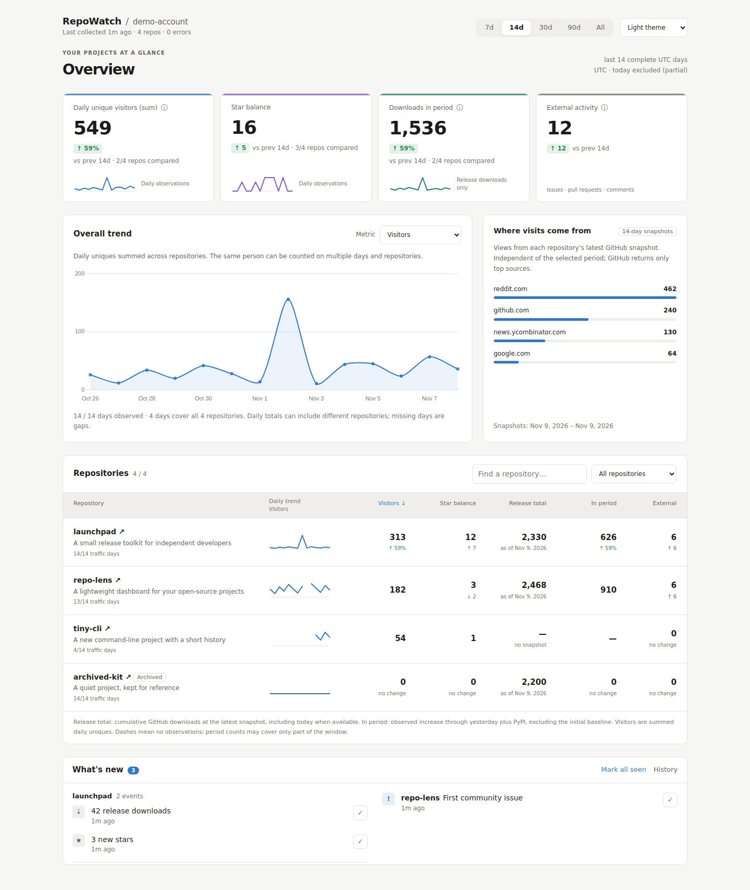

# RepoWatch

[](https://github.com/downlevel/repowatch/actions/workflows/ci.yml)
[](LICENSE)

**Self-hosted GitHub analytics for your own projects.** Keep daily traffic history beyond
GitHub's rolling 14-day window, track star balances and release downloads, and see what
changed across your public repositories in one dashboard.



*Screenshot uses fictional projects and synthetic data. [Dark theme](docs/screenshots/overview-dark.png)
· [Mobile view](docs/screenshots/overview-mobile.png).*

RepoWatch is an open-source application you run on your server, for **one GitHub account
per installation**. No signup service or TeleLogin account is required.
This is the first public beta; feedback and reproducible bug reports are welcome.

## What it does

- Stores daily views, daily unique visitors and clones in SQLite, retaining observations
  after they disappear from GitHub's traffic window.
- Tracks observed star balances, release-asset download counters and optional PyPI downloads.
- Shows an account overview, selectable daily trends, repository sparklines, referring sites,
  search, sorting and filters. Works on desktop and mobile, with light and dark themes.
- Surfaces new stars where names are available, forks, downloads, traffic spikes and
  issues/PRs/comments from people other than the owner, excluding recognised bots.
- Runs collection automatically with Docker Compose. A failed section does not stop the
  remaining sections; logs and the dashboard report collection status.
- Supports built-in Basic authentication or your existing authentication proxy.

## Before installing

- **Public repositories only**, belonging to the configured user or organisation. Forks
  are excluded by default; repository access and filters are configurable.
- **Traffic needs appropriate access to the repository**, not just knowledge of its name.
  RepoWatch cannot retrieve traffic for arbitrary third-party projects.
- The first collection can import GitHub's available **14 days of traffic**. Older traffic
  cannot be recovered; retention beyond that starts with your own stored observations.
- Star/download changes need subsequent snapshots. Short history and missing observations
  can mean no trend or no previous-period comparison yet.
- **Release total and period increase are different values.** The latest cumulative release
  total can include today; period counts and daily trends exclude today's partial UTC day.

## Quick start: Docker Compose

Requires Docker Engine with the Compose plugin. The image is built locally from source;
there is no registry account to configure.

```bash
git clone https://github.com/downlevel/repowatch.git
cd repowatch
cp .env.example .env
```

Edit `.env` before starting:

| Variable | What to enter |
| --- | --- |
| `GITHUB_OWNER` | Your GitHub username or organisation |
| `GITHUB_TOKEN` | A token with access to those repositories; see below |
| `DASHBOARD_USER` | Your dashboard login name |
| `DASHBOARD_PASSWORD` | Your own long, unique dashboard password |

Leave `DASHBOARD_AUTH=basic` for the built-in login. A GitHub token is not the dashboard
password. For passwords containing `$` or `#`, single-quote the value in `.env`.

```bash
docker compose up -d --build
docker compose ps
docker compose logs --tail=100 collector
```

Open **http://127.0.0.1:8765** and enter your dashboard credentials in the browser prompt.
The collector starts after the dashboard is healthy, collects immediately, then waits six
hours between runs. No host cron is needed for Docker. Data persists in a named volume.

The published port binds to **loopback** by default. On a remote server, use an HTTPS
reverse proxy or an SSH tunnel; `127.0.0.1` in your laptop's browser is your laptop, not
that server. Set `REPOWATCH_PORT` if the default port is already occupied.

[Full Docker guide: authentication, remote access, updates, backups and troubleshooting](docs/self-hosting.md).
For Python without Docker, use the separate [manual installation guide](docs/manual-installation.md).

## GitHub access

Create a [fine-grained personal access token](https://github.com/settings/personal-access-tokens/new)
for the account you monitor, granting access to all intended repositories or selecting them
explicitly. Discovery still lists public repositories; use `EXCLUDE_REPOS` to skip
repositories outside your token access. Start with **Administration: read** for traffic and **Metadata: read**.
Your GitHub identity must also have the repository access required by the traffic API;
setting a token permission does not grant access your account lacks.
[GitHub traffic API documentation](https://docs.github.com/en/rest/metrics/traffic).

RepoWatch uses read requests; do not grant write access just to obtain traffic or star
counts. If a section returns an access error, inspect the collector logs and that endpoint's
permissions. A token may also need organisation approval before it can access its repositories.

**Stargazer names are optional.** RepoWatch attempts the listing with the main token, or
with `GITHUB_STARS_TOKEN` when explicitly configured. If access is denied, it falls back
to daily star counters without names. GitHub documents listing restrictions for admins and
collaborators and more than one accepted permission set, including Metadata read; write
access is not an unconditional requirement. Check the
[current endpoint documentation](https://docs.github.com/en/rest/activity/starring#list-stargazers)
before changing permissions. A separate token is used only for the stargazer listing.

Keep `.env` private and out of Git. The Docker dashboard container does not receive the
GitHub token; the collector does. Optional PyPI collection contacts pypistats.org.

## Reading the numbers

| Display | Meaning |
| --- | --- |
| Visitors | Sum of daily unique visitors, also summed across repositories; not distinct people over the whole period |
| Star balance | Net change in observed star counters, including losses |
| Release total | Cumulative GitHub asset downloads at the latest snapshot, across releases; separate from PyPI |
| In-period downloads | Observed release counter increase plus PyPI downloads through yesterday; excludes the initial baseline when tracking began inside the period |
| Referring sites / popular pages | GitHub's top entries from the latest 14-day snapshots; independent of the period selector |
| External activity | Recorded issues, PRs and conversation comments from other people, excluding recognised bots |
| CI checkouts | An estimate from workflow job step names; the difference from clone counts does not measure human users |

Periods use complete **UTC days**. Missing observations are distinct from zero. Daily trend
tooltips report how many repositories contribute; changing coverage can change the aggregate.
The table shows per-repository traffic coverage. Comparisons identify when only a subset
of repositories is comparable. Coverage counts stored dates, not successful collection of
every individual source. Unseen events in the feed are independent of the selected period.

Asset counts include files such as checksums and signatures. In daily release trends,
deleted assets and reset counters leave gaps. Period counter differences can still be affected
by changes in the asset inventory; they are observed changes, not a measure of distinct installs.
A download, clone or visit does not establish a human user or prove attribution to a launch.

## Backups and upgrades

Your SQLite history is the durable record; GitHub cannot reconstruct old traffic. For Docker:

```bash
docker compose run --rm backup
docker compose run --rm backup backup --list
```

Backups are verified compressed SQLite copies in the data volume. Keep a copy outside that
volume too. Docker backups are manual unless you schedule them on your server.
`docker compose down` preserves the volume; adding `-v` deletes it and its history.

The [Docker operations guide](docs/self-hosting.md#operations) includes export, verified
restore and update commands. For a Python installation, use the
[manual backup/restore instructions](docs/manual-installation.md#backups-and-restore).
Stop web and collector processes before restoring; do not overwrite a running SQLite database
with a raw decompression command.

## Beta scope and feedback

Supported deployment: Docker on Linux, or Python 3.11+ on Linux with collection scheduled
by you. This beta has one configured GitHub account and one dashboard credential pair per
installation. There is no multi-user hosting service, launch annotation feature or public
interactive demo yet. Charts currently load Chart.js from jsDelivr, so the browser needs
access to that CDN as well as the dashboard.

To report a problem, [open an issue](https://github.com/downlevel/repowatch/issues/new) with
your version, installation method, selected period, expected/actual behaviour and redacted
collector logs. Never attach a token, password, `.env` or an unredacted private database.
See the [beta release notes](docs/releases/v0.1.0b1.md) for changes and upgrade requirements.

## Development

```bash
python3 -m venv .venv
.venv/bin/pip install -e '.[dev]'
.venv/bin/pytest
.venv/bin/python scripts/smoke-compose.py --build
```

CI runs tests on Python 3.11–3.13 and a fresh Docker installation against a fake GitHub API,
including login, collection, persistence and backup/restore. It needs no GitHub credentials.
The [architecture notes](docs/architecture.md) describe the collector and database.
To reproduce the documentation images, see [screenshots](docs/screenshots/README.md).

## License

[MIT](LICENSE).
